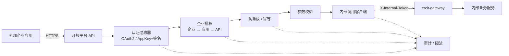

# 开放平台后端简要设计

> 版本 V0.2 · 设计阶段 · 2026-10-22  
> 范围：新建的开放平台后端服务。只讨论后端代码职责与核心链路，不展开部署、网络、等保测评和网关改造。

## 1. 定位与边界

开放平台后端是一个**独立的 Spring Boot 服务**，对外提供开放 API，对内调用现有 `crcit-gateway`。

**负责**

- 企业、应用、API 目录与订阅关系。
- 企业级授权：企业能开通哪些应用、应用能调用哪些 API。
- 接口鉴权：OAuth2 JWT 或 AppKey/AppSecret 签名。
- 防重放、防篡改、幂等。
- 请求参数校验、响应错误码。
- 以内部客户端身份调用 `crcit-gateway`。
- 应用层审计与限流计数。

**不负责**

- 网关路由、Sentinel 限流、JWT 用户认证等网关既有能力。
- WAF、DDoS、DMZ、IGP、mTLS 代理、IPsec。
- 等保测评、密评、信创选型、部署拓扑。
- 企业内用户级授权（本期只做企业级）。

**与网关的关系**

- 开放平台是 `crcit-gateway` 的内部客户端，不直接访问业务服务。
- 开放平台自己签发内部调用令牌；网关新增一个 Token Filter 校验（只写设计，不改现有代码）。
- 外部令牌不进入网关；内部令牌不返回外部。

## 2. 总体结构



模块划分：

- **auth**：OAuth2 token 签发/校验、AppKey/Secret 签名校验。
- **enterprise**：企业、应用、API 目录、订阅、scope。
- **authorization**：企业级授权判断、API 权限缓存。
- **replay**：timestamp、nonce、签名、JWT `jti`、幂等键。
- **internal**：内部令牌签发、网关路由映射、HTTP 调用。
- **audit**：应用层审计、错误码、限流计数。

建议技术栈：Java 17 + Spring Boot 3 + Spring MVC + Redis + MySQL（与现有后端栈保持一致）。不采用 WebFlux，降低数据库和事务代码复杂度；网关仍是 WebFlux。

## 3. 认证方式

### 3.1 OAuth2 客户端凭证（默认）

适用于大多数企业服务端到服务端调用。

- 平台提供 token 端点，校验 `client_id` + `client_secret`（或 `private_key_jwt`）。
- 签发 JWT，默认有效期 **15 分钟**，不签发 refresh token。
- JWT claims：`iss=open-platform`、`sub=app_id`、`aud=open-api`、`ent_id`、`app_id`、`scope`、`jti`、`iat`、`exp`、`auth_mode=oauth2`。
- 签名算法：外部 JWT 与内部令牌都默认 **RS256**（业内最通用、生态最成熟）；SM2/SM3 作为后续信创可选实现，通过 `TokenSigner` 接口切换，不作为首版默认。
- 平台用 `jti` 做撤销/黑名单；黑名单 TTL 等于 token 剩余有效期。
- **不默认做“严格一次性”**：客户端凭证模式下每个请求换 token 不经济，业内通用做法是短 TTL + 可撤销。若安全要求强制一次性，增加开关 `jti_one_time=true`，用 Redis `SETNX` 消费 `jti`，代价是 token 端点压力上升。
- 令牌只通过 `Authorization: Bearer` 传递，禁止放在 URL。

### 3.2 AppKey/AppSecret + 签名

适用于改造能力弱、无法接入 OAuth2 的合作方，或作为高敏感 API 的增强。

- 每个请求携带：`X-App-Id`、`X-Timestamp`、`X-Nonce`、`X-Signature-Method`、`X-Signature`、`Content-SHA256`。
- 待签名串：

```text
METHOD
PATH
CANONICAL_QUERY
X-TIMESTAMP
X-NONCE
SHA256(BODY)
```

- 使用 HMAC-SHA256（如密评要求可切 SM3）计算，Base64 输出；服务端用 AppSecret 验签。
- 时间戳允许 ±300 秒；nonce 在 Redis 保存 10 分钟，重复即拒绝。
- AppSecret 不下发、不进 URL、不进日志；服务端加密存储，支持轮换。
- 该模式下**所有外部 API 请求都必须签名**，不做“只签敏感接口”的例外。

### 3.3 选择建议

| 应用类型 | 认证方式 |
|:---|:---|
| 标准企业服务端 | OAuth2 + 短 JWT（默认） |
| 老系统/弱改造能力 | AppKey/AppSecret + 签名 |
| 资金、个人信息等敏感 API | OAuth2 + 请求签名（双保险） |

认证方式按应用配置 `auth_mode`，同一个应用不允许混用两种模式。

## 4. 企业级授权

只做企业级，不做企业内用户级。

采用业内常见的 **API 产品（API Product）/ API 分组** 模型：

- **API 产品是授权、订阅、配额的最小单元**，一个产品包含一组 API。
- 授权链路：**企业 → 应用 → API 产品 → scope**；应用订阅产品后，才获得产品内 API 的调用资格。
- `scope` 定义在产品上，如 `enterprise.read`、`enterprise.write`；产品内的单个 API 再声明自己需要的 scope。
- 默认不按“单个 API”逐项签约，避免企业接入时授权项爆炸；确需例外时，用 `api_whitelist` 做单 API 白名单。
- 大厂通常以 API 产品/套餐作为订阅单元，单个 API 只是产品内的条目；企业接入只签产品，不维护几十个 API 的逐项授权。
- 数据范围（字段、业务对象）作为产品/API 的授权属性，先按字段白名单和数据级别实现，不做行级复杂权限。

判断逻辑：

- 企业状态正常、应用已启用，才允许签发 token 或验签。
- 签发 token 时，校验请求的 `scope` 是否在企业已订阅的产品范围内；超出则拒绝。
- 请求进入时，校验 token 的 `scope` 是否覆盖目标 API，并校验应用与 API 产品的订阅关系（本地缓存 + 过期刷新）。
- 企业停用、应用停用、订阅到期时，token 立即失效或在下一次请求被拒绝；内部缓存设置短 TTL。

建议在授权判断中使用本地 Caffeine 缓存 + Redis 版本号，避免每次请求查库；企业/应用/订阅变更时递增版本号。

## 5. 防重放与幂等

### 5.1 OAuth2 模式

- `jti` 黑名单：撤销时写入 Redis，TTL 为 token 剩余有效期；每次请求校验。
- 严格一次性（可选）：`SETNX open:jti:{jti}`，TTL 为 token 剩余有效期；重复使用返回 401。
- TLS 已保证传输完整性；高敏感 API 再叠加请求签名。

### 5.2 AppKey/AppSecret 模式

- 时间戳：`|now - timestamp| <= 300s`。
- nonce：Redis key `open:nonce:{appId}:{nonce}`，`SETNX` + TTL 600s；重复即拒绝。
- 签名：按第 3.2 节待签名串计算，常量时间比较。
- 请求体摘要：`Content-SHA256` 与 body 实际摘要一致，防止 body 被改。
- 建议同时校验 `Content-Type` 和请求大小，避免超大报文绕过。

### 5.3 幂等

- 写接口支持 `Idempotency-Key`；Redis 保存 24 小时。
- 相同 key + 相同请求摘要：返回首次结果；相同 key + 不同摘要：409。
- 幂等与防重放分开：nonce 防重放，幂等键防业务重复提交。

## 6. 请求处理链

建议用 Spring MVC 的 `OncePerRequestFilter` 或 Spring Security FilterChain，顺序如下：

| 顺序 | 过滤器 | 职责 |
|:---|:---|:---|
| 1 | TraceIdFilter | 生成/透传 traceId，写入 MDC |
| 2 | AuthModeFilter | 解析应用与 `auth_mode`，加载应用状态 |
| 3a | OAuthTokenFilter | Bearer JWT 校验、`jti` 校验、scope 提取 |
| 3b | SignatureFilter | AppKey/AppSecret 验签、timestamp、nonce |
| 4 | EnterpriseAuthorizationFilter | 企业/应用/订阅/scope 校验 |
| 5 | ReplayFilter | 严格一次性 jti、幂等键（按需） |
| 6 | ApiPermissionFilter | API → scope/servicePermission 映射校验 |
| 7 | ValidationFilter | 请求体 Schema、大小、字段白名单 |
| 8 | InternalCallFilter | 获取内部 token、调用网关、超时/重试 |
| 9 | AuditFilter | 记录审计、耗时、结果 |

认证与签名二选一：由 `AuthModeFilter` 决定走 OAuth 还是签名，不能同时要求两套凭证（高敏感 API 可在 OAuth 之后追加签名校验，作为独立增强）。

## 7. 调用内网网关

- 开放平台用独立内部身份调用 `crcit-gateway`，不携带外部 token。
- 内部令牌：平台自签 JWT，`iss=open-platform`、`sub=open-platform-service`、`aud=internal-gateway`、`scope=api:invoke`、`api_id`、`exp=5 分钟`、`jti`。
- 请求头：`X-Internal-Token`、`X-Open-Request-Id`、`X-Open-App-Id`、`X-Open-Api-Id`、`X-Open-Trace-Id`。
- 网关新增 `InternalTokenAuth` Filter 校验签名、issuer、audience、过期时间、scope、api_id、来源 IP、路由白名单；详见 [内网网关 Token Filter 设计](internal-token-filter.md)。
- 路由映射：平台 API 只映射到固定的网关 route/servicePermission，禁止动态目标 URL。
- 超时/重试：查询类可重试 1 次；写入类默认不重试，除非带幂等键；熔断按 route 维度。
- 外部 app 身份只作为审计上下文透传，不作为网关授权依据。

## 8. 错误码与审计

- 401：未认证、token 无效/过期、签名失败。
- 403：应用停用、企业停用、无订阅、scope 不足。
- 409：幂等键冲突。
- 429：限流/配额。
- 500：内部错误，不返回堆栈。

审计记录应用、企业、API、认证方式、结果、错误码、耗时、traceId、请求摘要；不记录完整报文和密钥。

## 9. 设计取舍

- **新建独立服务**，不把企业/授权/审计塞进 `crcit-gateway`；网关只做路由、流控和内部 token 校验。
- **OAuth2 默认短 TTL + jti 撤销**，严格一次性作为可选开关，符合业内通用实践。
- **AppKey/AppSecret 模式全量签名**，不设“只签敏感接口”的例外。
- **内部调用新增 Token Filter**，不改现有网关代码；先设计，评审后再实现。
- **内部令牌使用 RS256**（业内最通用），网关只保存 RSA 公钥；SM2 作为后续可选实现，HS256 不作为长期方案。
- **企业授权按 API 产品/分组授权**，单 API 白名单只作例外，不默认逐 API 签约。

## 10. 待确认

1. 开放平台是否复用现有 `crcit-starter-base` / `crcit-starter-redis` / `crcit-cloud-core`？
2. 网关新增 Filter 的配置来源：Nacos 动态配置，还是随路由配置下发？
3. RS256 密钥管理：私钥/公钥的 PEM 存放位置、`kid` 轮换方式；SM2 作为后续可选实现，首版不阻塞。
4. API 产品的首批划分：按业务域（企业、订单、用户）还是按合作场景划分。
