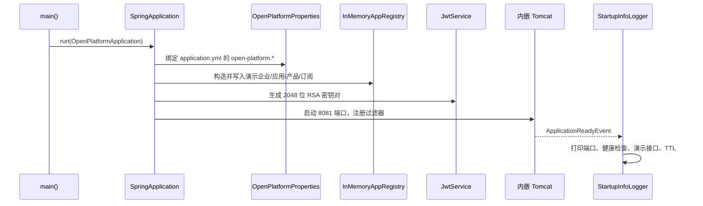
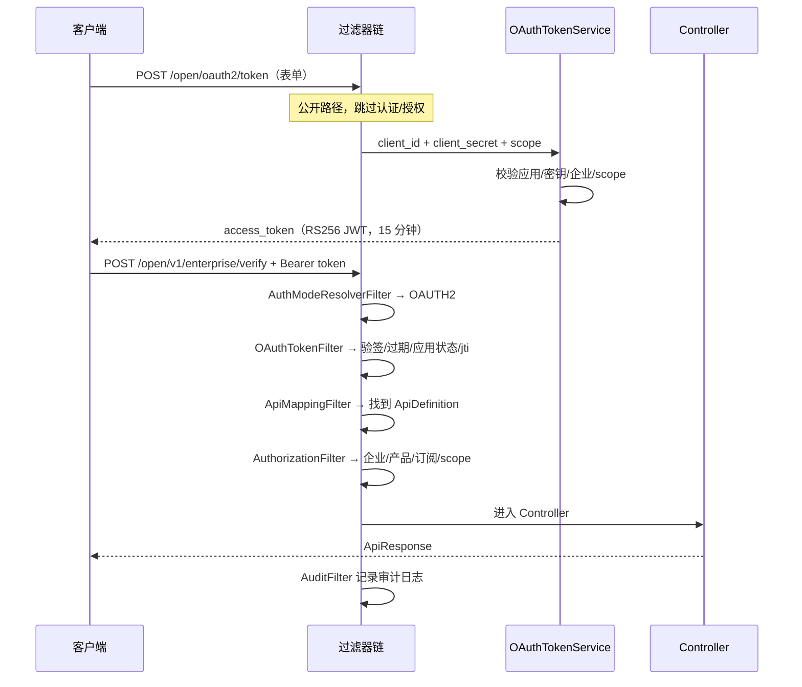
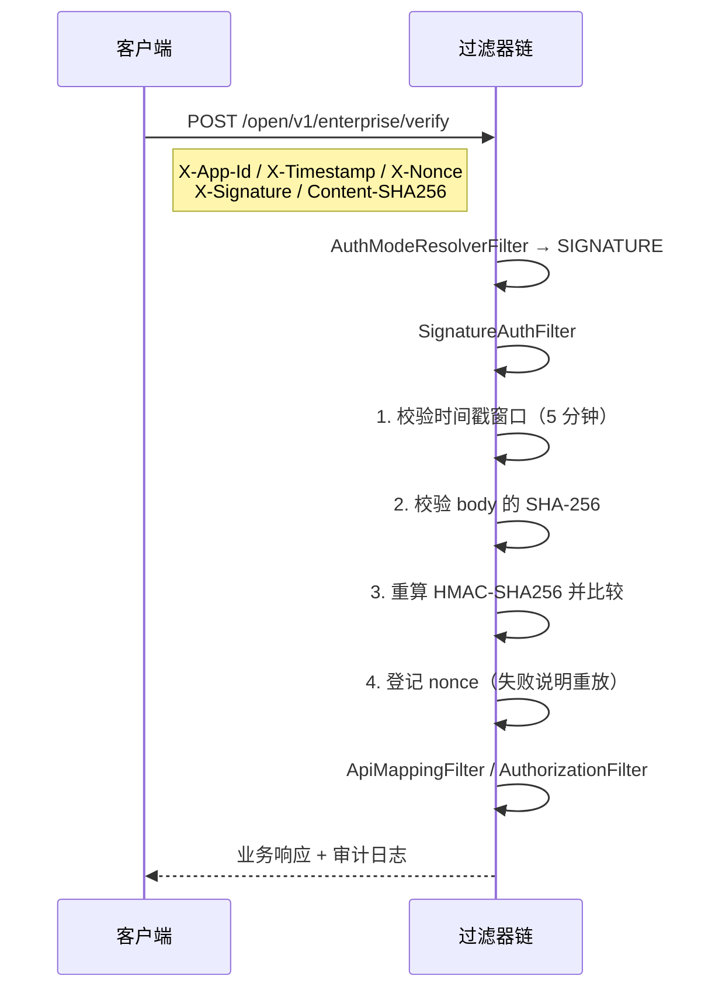

# 代码走读（新手向）

本文按“启动 → 认证 → 授权 → 业务 → 审计”的顺序，把关键类和调用关系串起来。建议配合源码里的中文 Javadoc 一起看。

## 1. 启动时发生了什么



关键类：

- [OpenPlatformApplication](../src/main/java/com/crcit/openplatform/OpenPlatformApplication.java)：入口，开了 `@EnableCaching` 和 `@EnableScheduling`；
- [OpenPlatformProperties](../src/main/java/com/crcit/openplatform/config/OpenPlatformProperties.java)：配置绑定；
- [StartupInfoLogger](../src/main/java/com/crcit/openplatform/config/StartupInfoLogger.java)：启动后打印“下一步该访问什么”。

## 2. OAuth2 模式：先换 token，再调接口



涉及类：

| 类 | 作用 |
|:---|:---|
| `OAuthController` | 令牌端点，只接受 `application/x-www-form-urlencoded` |
| `OAuthTokenService` | 客户端凭证校验、scope 校验、调用 `JwtService` 签发 |
| `JwtService` | RS256 签发/验签，校验 iss/aud/exp/iat |
| `OAuthTokenFilter` | 从 `Authorization: Bearer` 中解析并校验 token |
| `AuthContext` | 认证结果：企业、应用、scope、jti |

## 3. 签名模式：每个请求都带签名



签名失败时的错误码：

| code | 含义 |
|:---|:---|
| `40102` | 签名非法、摘要不一致、缺少请求头 |
| `40103` | 时间戳格式错误或超出时间窗 |
| `40104` | nonce 重复（重放） |

> 注意：签名模式下请求体需要被 `RequestCachingFilter` 缓存。当前实现**不缓存表单**
> （`application/x-www-form-urlencoded` 和 `multipart/`），因此签名接口请使用 JSON 请求体。

## 4. 过滤器顺序

| 顺序 | 类 | 职责 |
|:---:|:---|:---|
| 1 | `TraceIdFilter` | 生成/透传 requestId、traceId，写入 MDC 和响应头 |
| 2 | `RequestCachingFilter` | 缓存 JSON body，供签名和 MVC 重复读取 |
| 10 | `AuthModeResolverFilter` | 根据请求头决定用 OAuth2 还是签名（跳过 `/portal/**`） |
| 15 | `PortalAuthFilter` | 门户登录校验（只处理 `/portal/api/**`） |
| 20 | `OAuthTokenFilter` | OAuth2 token 校验 |
| 21 | `SignatureAuthFilter` | HMAC 签名、时间戳、nonce |
| 30 | `ApiMappingFilter` | METHOD + path → API 定义 |
| 40 | `AuthorizationFilter` | 企业级授权：应用/企业/产品/订阅/scope |
| 90 | `AuditFilter` | 审计日志（状态、耗时、身份） |

顺序常量集中在 `common/FilterOrder.java`。**不要随意调整**：授权依赖认证写入的 `AuthContext`，
审计依赖整条链路的结果。

## 5. 常见改动怎么做

### 新增一个演示应用

1. 在 `InMemoryAppRegistry.seed()` 里 `apps.put(...)`；
2. 如果新应用要订阅产品，补一条 `Subscription`；
3. README 的演示数据表同步更新。

### 新增一个 API

1. 在 `InMemoryAppRegistry.seed()` 里登记 `ApiDefinition`（method + path + product + scope）；
2. 在 `web/` 下新增 Controller；
3. 如果该 API 需要新权限点，在 `ApiProduct.scopes` 里加上，并在演示应用的产品中可见；
4. 如果该 API 是公开的，加入 `PublicPaths`（谨慎，公开路径不鉴权）。

### 替换内存存储为 MySQL

1. 新增一个 `AppRegistry` 的实现（如 `MyBatisAppRegistry`）；
2. 给原 `InMemoryAppRegistry` 去掉 `@Component`，给新实现加 `@Component`；
3. 认证/授权代码不需要改，因为它们只依赖 `AppRegistry` 接口。

### 替换防重放为 Redis

1. 新增 `RedisReplayGuard implements ReplayGuard`；
2. 用 `SET key value NX EX ttl` 实现 `markNonce/markJtiOnce`，用 `SETEX` 实现 `revokeJti`；
3. 替换 `InMemoryReplayGuard` 的 `@Component` 即可。

### 替换临时 RSA 密钥

1. 从 KMS 或 PEM 文件加载私钥/公钥；
2. 在 `JwtService` 中保留 `kid`，支持多个公钥并存；
3. 网关侧只配置公钥，不配置私钥。

### 调整有效期/超时

改 `application.yml` 的 `open-platform.*` 即可，无需改代码：

- `auth.token-ttl`：外部 token 有效期；
- `auth.internal-ttl`：内部 token 有效期；
- `auth.clock-skew`：时钟偏移容忍；
- `replay.timestamp-skew` / `replay.nonce-ttl`：防重放窗口；
- `internal.connect-timeout` / `internal.read-timeout`：内部网关超时。

## 6. 调试技巧

1. **先看 requestId**：响应头 `X-Request-Id` 和日志里的 `[req_xxx]` 是同一个值，用它过滤一次请求的全部日志。
2. **打开 DEBUG**：

   ```yaml
   logging:
     level:
       com.crcit.openplatform: DEBUG
   ```

   可以看到认证成功、token 缓存命中、nonce 清理等细节。
3. **单独跑测试**：`mvn test` 或 IDEA 里运行 `OpenPlatformFlowTest`，它覆盖 OAuth2 和签名两条链路。
4. **手工调用**：见 README 的 `curl` 示例和 `scripts/demo-signature.py`。
5. **签名总是不对**：先打印三样东西对照——`sha256Hex(body)`、待签名串、Base64 签名结果；
   最常见原因是 body 被重新序列化（空格/字段顺序变了）或时间戳单位写成秒。

## 7. 推荐阅读顺序

1. `README.md`（怎么跑、怎么调）
2. `OpenPlatformApplication`（入口）
3. `common/FilterOrder` + `common/PublicPaths`（链路和公开路径）
4. `auth/AuthModeResolverFilter` → `OAuthTokenFilter` / `SignatureAuthFilter`
5. `authorization/ApiMappingFilter` → `AuthorizationFilter` → `EnterpriseAuthorizationService`
6. `oauth/JwtService`、`signature/SignatureService`
7. `internal/*`（内部调用）
8. `web/*`（业务示例）
9. `docs/backend-design.md`（为什么这么设计）

## 8. 门户（Portal）代码导览

门户是“前端 + 后端”两个服务，后端代码在 `com.crcit.openplatform.portal`，前端在 `frontend/`。

### 8.1 门户登录链路

```text
POST /portal/api/auth/login
  → PortalAuthController.login
  → PortalStore.findUserByEmail
  → PasswordHasher.matches（PBKDF2 常量时间比较）
  → PortalTokenService.issue（独立 RSA，aud=portal-console，TTL 8h）
  → 前端 localStorage 保存 token

后续 /portal/api/**
  → PortalAuthFilter（Order 15）
  → PortalTokenService.verify
  → request attribute PortalPrincipal
  → Controller 通过 PortalControllerSupport.principal 获取当前登录人
```

### 8.2 门户核心类

| 类 | 作用 |
|:---|:---|
| `PortalStore` | 内存版用户/应用/申请数据，启动时写演示数据 |
| `PortalTokenService` | 门户 JWT 签发/校验，与开放 API token 隔离 |
| `PortalAuthFilter` | 保护 `/portal/api/**`，登录接口放行 |
| `PortalAppService` | 创建应用、查看/轮换密钥、应用列表 |
| `PortalAccessService` | 提交申请、审批、通过后调用 `grantProduct` |
| `PortalCatalogService` | API 目录/详情/产品，文档内置在代码中 |
| `PortalDashboardService` | 首页统计、引导步骤、公告 |
| `PortalUsageService` | 按企业聚合开放 API 调用量 |
| `UsageTracker` | `AuditFilter` 写入的调用记录（内存 5000 条） |
| `PortalCorsConfig` | 开发期前端跨域配置 |

### 8.3 一次完整的接入闭环

```text
开发者创建应用
  → InMemoryAppRegistry.registerApp（初始 productCodes 为空）
  → 提交申请
  → 管理员审批通过
  → InMemoryAppRegistry.grantProduct
      ├─ 更新应用的 productCodes
      └─ 新增 Subscription
  → 应用换 OAuth2 token 时，OAuthTokenService 通过 scopesForApp 拿到新 scope
  → AuthorizationFilter 校验订阅 + scope
  → 调用成功
```

### 8.4 前端页面

| 页面 | 文件 | 关键交互 |
|:---|:---|:---|
| 登录 | `pages/LoginPage.tsx` | 演示账号快速填充 |
| 概览 | `pages/DashboardPage.tsx` | 统计卡、引导步骤、最近调用、公告 |
| 目录 | `pages/CatalogPage.tsx` | 搜索/方法/产品筛选 |
| 详情 | `pages/ApiDetailPage.tsx` | 文档、示例、错误码、申请接入弹窗 |
| 应用 | `pages/AppsPage.tsx` | 创建、查看/复制/轮换密钥 |
| 申请 | `pages/RequestsPage.tsx` | 开发者提交、管理员审批 |
| 统计 | `pages/UsagePage.tsx` | 趋势图、API 排行、最近调用 |
| 指南 | `pages/GuidePage.tsx` | OAuth2 / HMAC 示例 |

### 8.5 门户请求为什么不会被开放 API 过滤器拦截

`PublicPaths.isPortal(request)` 会识别 `/portal/**`，开放 API 的认证/映射/授权过滤器都在
`shouldNotFilter` 中跳过；随后由 `PortalAuthFilter` 独立校验门户 token。

新增门户路径时：

- 不需要加入 `PUBLIC_PATHS`（那是开放 API 的公开路径）；
- 除登录外，默认都会被 `PortalAuthFilter` 保护；
- 如果是新的公开门户接口，需要在 `PortalAuthFilter.shouldNotFilter` 中显式放行。
